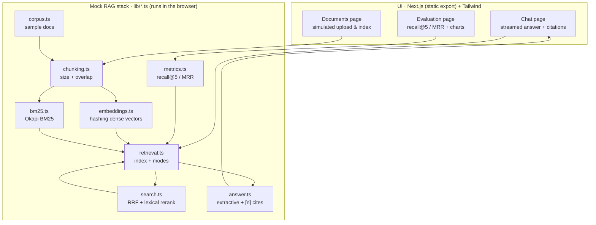
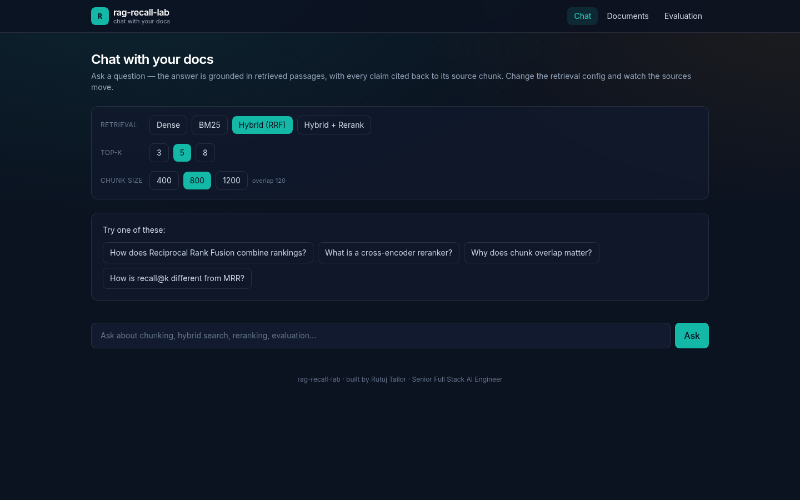
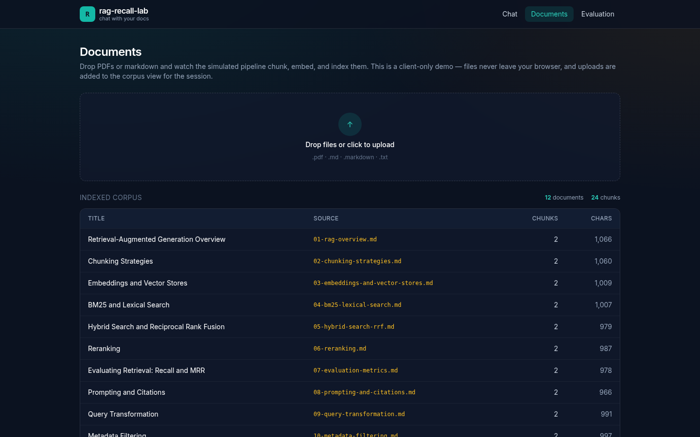
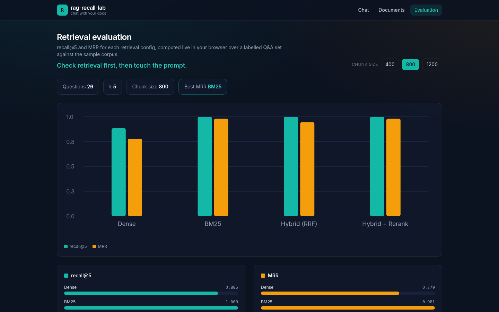

# rag-recall-lab

> **Chat with your docs — a RAG lab that treats retrieval as the thing to measure first.**
>
> *"Check retrieval first, then touch the prompt."*

An interactive, **frontend-only** demo of a Retrieval-Augmented Generation
workflow. Browse a sample knowledge base, ask questions and watch grounded
answers **stream in with cited source cards**, flip between four retrieval
configs and see the sources move, and open an **evaluation dashboard** that
scores each config on **recall@5** and **MRR**.

The headline idea: retrieval sets the quality ceiling of a RAG system, so you
should measure and tune retrieval *before* you reach for the prompt.

> **Frontend-only demo.** There is no backend, no API keys, and no network
> calls. The entire RAG stack — chunking, a hashing dense embedder, Okapi BM25,
> Reciprocal Rank Fusion, a lexical reranker, the extractive answerer, and the
> eval harness — is implemented as plain TypeScript modules under `lib/` and runs
> in your browser. Numbers are computed live from that mock stack, not hard-coded.
> It builds to a fully static site (`next build` → `out/`) deployable to Vercel,
> Netlify, or any static host.

*By **Rutuj Tailor**, Senior Full Stack AI Engineer.*

---

## Features

- 💬 **Streamed grounded chat** — answers stream in token-by-token with inline
  `[n]` citations, each backed by a source card showing the chunk, its origin,
  and its retrieval score.
- 🎛️ **Live retrieval config** — toggle **dense**, **BM25**, **hybrid (RRF)**, or
  **hybrid + rerank**, plus **top-k** and **chunk size**. Every knob genuinely
  re-runs retrieval, so the sources and answer change in front of you.
- 📄 **Simulated ingestion** — drag-and-drop upload with a staged, animated
  chunk → embed → index progress bar, then the file joins the indexed corpus
  view. Files never leave the browser.
- 📊 **Evaluation dashboard** — **recall@5** and **MRR** per config over a
  labelled Q&A set, rendered with a hand-drawn **SVG** grouped bar chart plus CSS
  bars (no charting dependencies). Change the chunk size and watch the metrics move.
- 🎨 **Polished UI** — Next.js App Router + Tailwind, dark navy `#0b1220` with
  teal and amber accents.
- ✅ **Tested** — a `vitest` unit suite covers the mock retrieval and metrics.
- 🪶 **Zero heavy deps** — no vector DB, no chart library, no server runtime.

---

## Architecture

The "pipeline" is entirely client-side — these are TypeScript modules, not
services — but it mirrors a real RAG system stage for stage.



**Query path:** embed the question → dense + BM25 candidate lists → fuse with RRF
→ (optionally) rerank → feed the top-k chunks to the extractive answerer →
stream back a cited answer. The same retrieval core powers both the chat and the
eval page, so the numbers on the dashboard describe exactly what the chat uses.

---

## Quickstart

```bash
npm install
npm run dev      # http://localhost:3000
```

The sample corpus is bundled, so the chat, documents, and eval pages work
immediately — no upload, no configuration.

### Test / build

```bash
npm test          # vitest unit suite for mock retrieval + metrics
npm run build     # static export → ./out
```

---

## Deploy

`next.config.mjs` sets `output: "export"` with `images.unoptimized: true`, so
`npm run build` emits a fully static site to `out/` with no server runtime.

- **Vercel** — import the repo; it detects Next.js and serves the static export.
- **Netlify** — build command `npm run build`, publish directory `out`.
- **GitHub Pages / any static host** — upload the contents of `out/`.

---

## Evaluation explained

The eval dashboard answers one question: **did retrieval even surface the right
passage?** It runs the labelled Q&A set (`lib/metrics.ts`) against the sample
corpus and reports, per retrieval config:

- **recall@5** — fraction of questions where a relevant chunk appears in the top
  5 results. A chunk is *relevant* when its source document matches the gold
  answer. Low recall means the answer was doomed before the model ever ran.
- **MRR (Mean Reciprocal Rank)** — `1 / rank` of the first relevant chunk,
  averaged across questions. Rank 1 → `1.0`, rank 2 → `0.5`, rank 5 → `0.2`. MRR
  rewards putting the best passage *first*, where a model attends most.

Switching retrieval config moves these numbers far more than prompt tweaks do —
which is why the page leads with its tagline: **check retrieval first, then touch
the prompt.**

---

## Project layout

```
rag-recall-lab/
├── app/                 # Next.js App Router pages
│   ├── page.tsx         # chat (streamed answers + retrieval controls)
│   ├── documents/       # simulated upload + indexed corpus
│   └── eval/            # recall@5 / MRR dashboard + charts
├── components/          # NavBar, ModeBadge, RetrievalControls
├── lib/                 # the mock RAG stack (see Architecture)
│   ├── corpus.ts        #   sample documents
│   ├── chunking.ts      #   word-boundary chunker (size + overlap)
│   ├── embeddings.ts    #   deterministic hashing dense embedder
│   ├── bm25.ts          #   Okapi BM25
│   ├── search.ts        #   RRF fusion + lexical reranker
│   ├── retrieval.ts     #   index build + four retrieval modes
│   ├── answer.ts        #   extractive answerer with [n] citations
│   ├── mockChat.ts      #   token-by-token streaming orchestration
│   └── metrics.ts       #   labelled Q&A set + recall@5 / MRR
├── tests/               # vitest suite (retrieval + metrics)
├── docs/screenshots/    # README images
└── LICENSE              # MIT
```

---

## Screenshots

### Chat — streamed, grounded answers with citations


### Documents — simulated upload & indexed corpus


### Evaluation — recall@5 / MRR per config


---

## License

MIT © 2026 Rutuj Tailor — see [LICENSE](LICENSE).
